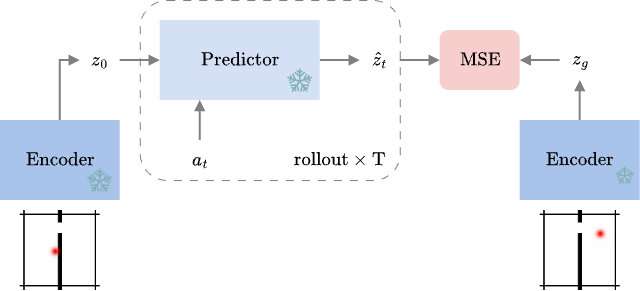
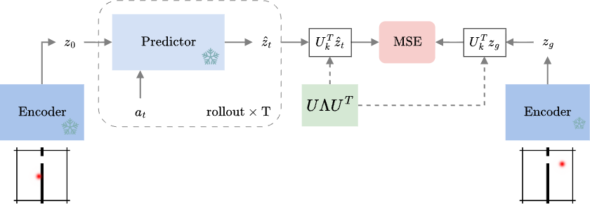

<h1 align="center">Latent Projection for Latent Planning</h1>

<p align="center">
  <em>Planning costs that measure only the directions carrying the state dynamics.</em>
</p>

<p align="center">
  
</p>

---

## Overview

Official implementation of **Latent Projection for Latent Planning**.

Latent world models plan by scoring candidate rollouts with an $l^2$ distance between the predicted
latent and the goal latent. But the strict Gaussian regularization that keeps these representations
from collapsing also makes them noisy: many latent directions carry little the model can predict,
and $l^2$ weights them all the same.

We fit the state dynamics $A$, which also pins the covariance of the transition noise. Its
eigenvectors along the least uncertain directions capture the clean state dynamics, and we measure
the planning cost along them. **Everything is post-hoc** — frozen encoder, frozen predictor,
unchanged planner. Fitting one linear map $A$ is the entire intervention.

> On TwoRoom's harder setting, this takes planning success from **60.0% → 96.7%** while measuring
> the residual in a **32-dimensional** subspace of the 192-dimensional latent. On PointMaze it is
> **42.0% → 96.7%**, from 4 dimensions.

<table>
<tr>
<td width="50%" align="center"><b>(a) Latent planning</b></td>
<td width="50%" align="center"><b>(b) Latent projection for latent planning</b></td>
</tr>
<tr>
<td width="50%"></td>
<td width="50%"></td>
</tr>
</table>

<p align="center"><sub>
(a) A candidate action sequence is rolled out through the frozen predictor, and its terminal latent
is compared to the goal by squared distance.
(b) Ours: the same comparison, made after both latents are projected onto the retained directions
<code>U<sub>k</sub></code>.
</sub></p>

---

## Results

Planning success rate (%) by retained rank $k$ on the harder setting: planning horizon 10, goal
drawn 50 steps ahead, a 100-step budget. Mean ± std over the 3 fits of $A$, on the validation
seed, where the rank is chosen.

*Ours* projects onto the $k$ least uncertain directions of the fitted $A$; *random* onto $k$
columns of a random orthogonal matrix, the control that separates the fitted basis from mere
dimensionality reduction. At $k = 192$ every basis recovers the plain $l^2$ cost, so both rows share
that run. **Bold** marks the best rank, the $k^*$ carried forward.

| Task | Basis | 2 | 4 | 8 | 16 | 32 | 64 | 128 | 192 ($l^2$) |
|---|---|---|---|---|---|---|---|---|---|
| **TwoRoom** | ours | 21.3<sub>±3.1</sub> | 64<sub>±5.3</sub> | 88<sub>±3.5</sub> | 92.7<sub>±1.2</sub> | **94.7<sub>±3.1</sub>** | 84<sub>±2</sub> | 74<sub>±0</sub> | 60 |
|  | random | 13.3<sub>±5</sub> | 22.7<sub>±2.3</sub> | 30<sub>±3.5</sub> | 38<sub>±6</sub> | 42.7<sub>±7.6</sub> | 52<sub>±12.5</sub> | 50<sub>±2</sub> | 60 |
| **PointMaze-UMaze** | ours | 96.7<sub>±1.2</sub> | **98<sub>±0</sub>** | 92.7<sub>±1.2</sub> | 76<sub>±3.5</sub> | 60<sub>±0</sub> | 48.7<sub>±5.8</sub> | 50.7<sub>±2.3</sub> | 56 |
|  | random | 37.3<sub>±6.4</sub> | 46<sub>±6.9</sub> | 50<sub>±14</sub> | 60.7<sub>±7</sub> | 50<sub>±2</sub> | 48.7<sub>±8.1</sub> | 58<sub>±3.5</sub> | 56 |
| **PointMaze-Medium** | ours | 82<sub>±8</sub> | 85.3<sub>±1.2</sub> | 88.7<sub>±1.2</sub> | 90<sub>±0</sub> | **94<sub>±0</sub>** | 73.3<sub>±2.3</sub> | 60.7<sub>±1.2</sub> | 60 |
|  | random | 40.7<sub>±9.5</sub> | 48<sub>±7.2</sub> | 48.7<sub>±4.2</sub> | 58.7<sub>±8.3</sub> | 56<sub>±5.3</sub> | 60<sub>±4</sub> | 57.3<sub>±4.2</sub> | 60 |
| **OGBench-Cube** | ours | 44<sub>±2</sub> | **54<sub>±7.2</sub>** | 50.7<sub>±1.2</sub> | 53.3<sub>±4.6</sub> | 50<sub>±2</sub> | 48<sub>±5.3</sub> | 50<sub>±0</sub> | 52 |
|  | random | 41.3<sub>±1.2</sub> | 44<sub>±4</sub> | 50<sub>±3.5</sub> | 48.7<sub>±1.2</sub> | 46<sub>±5.3</sub> | 50<sub>±3.5</sub> | 47.3<sub>±2.3</sub> | 52 |
| **Reacher** | ours | 45.3<sub>±3.1</sub> | 82<sub>±5.3</sub> | 71.3<sub>±2.3</sub> | 74.7<sub>±7.6</sub> | 76.7<sub>±6.4</sub> | 74<sub>±2</sub> | **84<sub>±3.5</sub>** | 84 |
|  | random | 30.7<sub>±4.2</sub> | 50.7<sub>±8.1</sub> | 65.3<sub>±6.4</sub> | 66.7<sub>±8.1</sub> | 72<sub>±6.9</sub> | 74.7<sub>±2.3</sub> | 77.3<sub>±11.4</sub> | 84 |
| **PushT** | ours | 4.7<sub>±3.1</sub> | 7.3<sub>±2.3</sub> | 14.7<sub>±1.2</sub> | 22<sub>±4</sub> | 26.7<sub>±6.4</sub> | 24.7<sub>±3.1</sub> | **35.3<sub>±2.3</sub>** | 30 |
|  | random | 1.3<sub>±2.3</sub> | 8<sub>±4</sub> | 15.3<sub>±1.2</sub> | 20.7<sub>±5</sub> | 32<sub>±3.5</sub> | 30<sub>±2</sub> | 34<sub>±0</sub> | 30 |

## Installation

Requires Python ≥ 3.10 and a CUDA-capable GPU. The world models, environments and planner come from
our pinned fork of [stable-worldmodel](https://github.com/galilai-group/stable-worldmodel), which
adds the PointMaze environments.

```bash
git clone https://github.com/yjang43/lp2.git
cd lp2
uv venv --python=3.10 && source .venv/bin/activate
uv pip install -r requirements.txt
```

The code runs from the repository root; nothing in `lp2` itself needs installing.

### Datasets and world models

Datasets and pretrained world models for all six tasks are in the
[$\text{LP}^2$ HuggingFace collection](https://huggingface.co/collections/yjang43/lp-6aa6022882b0184786d293d4).

```bash
export STABLEWM_HOME=$PWD
```

Datasets are `.tar.zst` archives extracted to `datasets/`; a world model is a `config.json` +
`weights.pt` under `checkpoints/<task>/lewm/`. For TwoRoom:

```bash
# dataset -> $STABLEWM_HOME/datasets/tworoom.h5  (tar --zstd needs zstd)
mkdir -p $STABLEWM_HOME/datasets
hf download yjang43/lp2-tworooms tworoom.tar.zst --repo-type dataset --local-dir /tmp/dl
tar --zstd -xvf /tmp/dl/tworoom.tar.zst -C $STABLEWM_HOME/datasets && rm -r /tmp/dl

# world model -> $STABLEWM_HOME/checkpoints/tworooms/lewm/
hf download yjang43/lp2-tworooms config.json weights.pt \
    --local-dir $STABLEWM_HOME/checkpoints/tworooms/lewm
```

The TwoRoom, PushT, Reacher and OGBench-Cube datasets and world models are those released by
[LeWM](https://github.com/lucas-maes/le-wm). The two PointMaze mazes were collected with our
[stable-worldmodel fork](https://github.com/yjang43/stable-worldmodel) and need both of their
datasets: the world model and $A$ are fit on the random-policy set, while the evaluation start
and goal pairs are drawn from the expert set.

### Fitted heads

The fitted $A$ behind every reported number ships with this repository, beside the world model
it was fit on:

```
checkpoints/tworooms/lewm/weights.pt               # downloaded
checkpoints/tworooms/lewm/normal_drift_seed0/      # shipped
```

---

## Quick Start

Plan with a drift:

```bash
python eval.py --config-name=tworoom_hard \
    policy=tworooms/lewm/weights.pt \
    cost=lp2 cost.k=32 \
    cost.drift_ckpt=tworooms/lewm/normal_drift_seed0/drift_epoch_50.pt
```

Baselines swap only the cost: `cost=l2`, `cost=random cost.k=32 cost.seed=0`,
`cost=pca cost.k=8 cost.drift_ckpt=tworooms/lewm/pca/pca.pt`, or
`cost=td cost.td_ckpt=tworooms/lewm/td_seed0/td_epoch_10.pt`.

To fit your own $A$ instead, with the encoder and predictor frozen:

```bash
python fit.py --config-name=normal_drift data=tworoom \
    pretrained_ckpt=tworooms/lewm/weights.pt
```

It lands in `checkpoints/tworooms/lewm/normal_drift/`, beside the shipped ones rather than on top
of them.

The ablation arms are the same command with `--config-name` set to `non_normal_drift`,
`non_psd_normal_drift`, `linear_drift`, `symmetric_drift` or `single_step_normal_drift`.

---

## License

MIT — see [LICENSE](LICENSE).
